# Architecture and operational boundaries

The source profile, version store and target session have separate ownership. Source discovery and copying read source files only. Upstream Playwright processes receive only private clone or target profile paths.

```mermaid
flowchart LR
    S[macOS source profile] -->|read files| F[Private frozen staging]
    F -->|SQLite ONLINE BACKUP| C[Private clone]
    C -->|matching browser through playwright-cli| E[Validated storage state]
    E --> V[Immutable source version]
    V -->|sync or SSH receive| T[Immutable target version]
    T -->|next start only| P[Clean persistent session profile]
```

## Source copy and decryption

A Chrome source is selected by browser channel and profile directory. Bundle identity is checked with macOS `plutil`. Default application locations include `/Applications` and the user's `Applications` directory. Config can provide an explicit matching app. Profile display names are informational.

The copier rejects symlinks and special files. It excludes caches, process locks, debugging-port files, session stores, password databases and certificate stores. Every copied ordinary file is opened and read fully. SQLite file signatures, standard database names and `.sqlite` suffixes select the SQLite path. Missing Cookies, Preferences or Local State fails before browser launch.

Opening a live WAL source directly with SQLite `mode=ro` can still modify or create its SHM file. Instead Python copies main DB, WAL and rollback journal bytes to private staging. It compares the entire source member set before and after copying, including presence, device, inode, size, modification and change timestamps. A changed set causes a bounded whole-set retry. It does not copy source SHM. SQLite opens the staged copy, performs integrity checks and ONLINE BACKUP into the clone. No SQLite API opens a source path. This is a best-effort frozen database image, not a multi-store transaction.

The matching headless browser opens the clone through unmodified playwright-cli. The clone omits current and historical session/tab files, resets startup preferences to an empty last session, and disables extensions. `--restore-last-session` retains session cookies without restoring the daily tabs. Source preference files remain untouched. Startup pages must be `about:blank` before cookie capture. Chromium distinguishes [restoring session cookies from ordinary cookie persistence](https://chromium.googlesource.com/chromium/src/%2B/f07119083cea55cddff38397f1694a41f282ad6e/services/network/public/mojom/network_context.mojom). Source export uses the supported `ignoreDefaultArgs` launch option to omit `--password-store=basic` and `--use-mock-keychain`; those upstream defaults would prevent use of the source application's macOS Keychain. Target sessions keep the upstream defaults. Keychain access may require the user's normal system authorization; refusal fails closed. `run-code` calls `context.storageState({path, indexedDB})`. It never returns cookie values to stdout and does not require `require` or `process` in the upstream VM. Source cookie metadata contains only identity, partition and known plaintext nonempty status for unexpired cookies. Every selected unexpired source cookie must appear in browser output. A known nonempty source plaintext value that becomes empty fails. An encrypted record may legitimately decrypt to an empty value; ciphertext length does not establish plaintext nonemptiness. Browser decryption and corruption log signals also fail. SQLite integrity failures abort copying.

This catches dropped encrypted records and browser-reported decryption errors. It cannot detect a retained encrypted identity with a silently wrong or empty value without an independent plaintext oracle. A non-SQLite store can be fully readable yet logically damaged. Browser errors and suspicious empty replacement checks catch detectable damage, but there is no independent oracle for a first export of silently empty origin storage. The CLI reports that limitation in each source receipt. A previously nonempty cookie collection cannot be replaced by an empty collection. Previously nonempty localStorage or IndexedDB collections for a retained origin cannot be replaced by empty collections. Complete removal of an origin is permitted as an explicit scope reduction.

Only configured origins are navigated to capture localStorage and IndexedDB. Navigation outside the exact origin is blocked, and response status plus final origin are checked. Origin storage capture is rejected as a whole if any requested origin fails. Cookie scope is captured before navigation so navigation cannot silently expand the exported cookie set.

## Atomic state and transport

The canonical digest is SHA-256 over `JSON.stringify(state)` after strict validation. A receive input is limited to 64 MiB and validated before activation. Stored cookies require the fields used by the pinned upstream NetworkCookie schema. Expiry must be -1, or between 0 and 253402300799 inclusive, matching the upstream rewriteCookies check. Empty cookie values and names remain valid strings. Directory names use generated timestamp UUID versions. An immutable version holds both its envelope and a plain state file. A staging directory is renamed before atomically replacing `current.json`. Readers see the old complete version or the new complete version. Loading checks both envelope digest and separate state file digest.

A per-entity atomic mkdir lock serializes activation with session start. A separate session lock survives the CLI process and owns the persistent browser. Refresh never mutates that context. SHA-256 protects accidental transfer/storage corruption; SSH supplies transport authentication. This is not a signature scheme or defense against a hostile same-user process.

SSH executes the same installed version with absolute Node, CLI and data-root paths. It does not distribute code. The receiver writes to its private version staging area and activates only after validation. Session start and stop use the same remote contract. A lost reply after activation is ambiguous and must be reconciled using remote status.

## Upstream contract

Pinned versions are in package-lock.json. The inspected local 0.1.24 code exposes:

- `open --config=... --profile=... --idle-timeout=0` and `run-code --filename=...`.
- Browser config `browser.browserName`, `browser.isolated`, `browser.userDataDir`, `browser.launchOptions` and `browser.contextOptions`.
- Registry workspace discovery: walk up from cwd for `.playwright`, at most ten levels. The workspace path determines the daemon registry key.
- `PWTEST_CLI_GLOBAL_CONFIG` overrides the root for global `.playwright/cli.config.json`. Merely providing `--config` does not bypass global config merging.
- `PWTEST_DAEMON_SESSION_DIR` isolates daemon metadata and error output. These two upstream environment interfaces are version-specific and must be rechecked on upgrade.
- `PLAYWRIGHT_MCP_*` environment config merges after file config. Child environments remove all `PLAYWRIGHT_*` and `PWTEST_*` inherited values before setting the isolated private roots.
- `context.setStorageState(path)` does not reliably clear old unvisited disk origins. Every managed start therefore creates a new persistent profile.

Inspection sources: project-local `node_modules/playwright-core/lib/tools/cli-client/registry.js`, `session.js`, `program.js`, and `node_modules/playwright-core/lib/coreBundle.js`. These are Microsoft's installed published artifacts, not patched copies. The package origin is [Microsoft playwright-cli](https://github.com/microsoft/playwright-cli).

No code imports Playwright to launch or connect a browser. The only browser entry point is child execution of the package's original CLI. Private `.playwright` workspaces and exact invocation examples make session identity independent of the caller's directory.

## Cleanup and failures

Profile, workspace and ownership-file preparation share the same start cleanup boundary. A preparation failure before browser launch removes the newly created lock. SIGINT and SIGTERM terminate active child commands, prevent state activation, and let enclosing finally blocks attempt owned browser close. SIGKILL, machine shutdown and an uncooperative external process cannot be cleaned synchronously. If liveness is uncertain, the CLI retains the profile and lock rather than deleting files under a live browser. Status exposes unknown or stale occupancy. A retained source export clone is private but may contain credentials; inspect the recorded private temp path before manual cleanup. No automatic process kill or daily browser shutdown is used.

Timeouts terminate the CLI child, then owned cleanup runs. They do not justify freeing a lock. Session stop confirms that no process references its exact profile before deleting its lock and session profile. Persistent browser state belongs only to a single managed session and is discarded after confirmed stop. An operation lock left by abrupt termination requires operator inspection.

launchd jobs are created only by explicit schedule enable. Labels include a digest of the absolute data root to prevent collision with another installation. A job uses the absolute current Node and built CLI path, private cwd and data root, deterministic PATH, and an hourly default StartInterval. Install/build do not touch launchd. Jobs refresh only; sync and session operations remain explicit.
